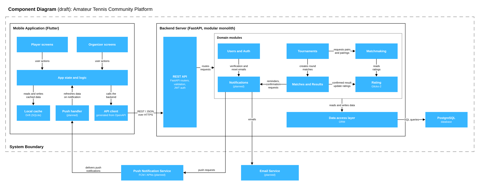

# Component Diagram (draft)

The diagram shows the main software components of the Amateur Tennis Community Platform and how they talk to each other. It zooms in on the two parts from the system context diagram, the mobile application and the backend server, and shows what each of them is made of.

The notation is kept simple: each blue box is a component and each arrow is an interaction, labelled with what it does. The black frames group the components of the mobile app and the backend. Everything inside the grey dashed frame is part of our system, and the push and email services below it are external. Components marked "(planned)" are "could have" or "should have" features (see `docs/requirements/requirement-priorities-and-acceptance-criteria.md`) and aren't needed for the first version.

The technologies match the technology comparison (`docs/comparisons/technology-alternatives.md`): Flutter for the app, Drift for the optional local cache, FastAPI as a modular monolith for the backend, PostgreSQL for the database and Glicko-2 for ratings.

## Mobile application (Flutter)

- **Player screens.** Profile, opponent and partner search, tournament sign-up, result entry, result confirmation and dispute, rating and match history.
- **Organizer screens.** Tournament setup, registrations, generated doubles pairs and round pairings, schedule, dispute resolution and results.
- **App state and logic.** View models and the rules that run on the device. Both sets of screens go through it, so they never call the backend directly. The state management library isn't chosen yet.
- **Local cache** (planned). A Drift (SQLite) database holding tournaments, schedules and match history, so the app can show them without waiting for the network. It is a "could have" feature and never stores tokens or passwords.
- **API client.** A Dart client generated from the backend's OpenAPI description. This keeps the app in sync with the API without writing request code by hand. Session tokens are kept in the platform's secure storage (Keychain / Keystore), not in the local cache.
- **Push handler** (planned). Receives push notifications and tells the app to refresh the related data.

## Backend server (FastAPI, modular monolith)

- **REST API layer.** FastAPI routers, request validation with Pydantic, the generated OpenAPI description and JWT authentication with short-lived, revocable sessions. It is the only entry point to the backend and passes each request to the right module.
- **Users and Auth.** Accounts, privacy-notice consent, login and sign-out, account deletion and player profiles.
- **Tournaments.** Tournament formats (singles or doubles), registrations and withdrawals, Swiss-style rounds, the schedule and standings.
- **Matchmaking.** The logic that matches players by rating: opponent and partner suggestions, automatic doubles pairs and round pairings. It doesn't store ratings itself and reads them from the Rating module.
- **Matches and Results.** Submitting results, confirmation or dispute by the opponent, dispute resolution by the organizer, the audit trail of result changes, match history and statistics.
- **Rating.** Glicko-2 ratings, kept separately for singles and doubles, along with rating history and the NTRP-style level shown to players. Ratings change only when a result is confirmed or a dispute is resolved. Each confirmed match is processed as its own rating period, and the rating deviation grows with the time since a player's last match. A plain Elo implementation sits behind the same interface as a fallback and evaluation baseline.
- **Notifications** (planned). Turns events into push messages and emails: match reminders, result confirmation requests, account verification and password reset.
- **Data access layer.** ORM models and database migrations. The exact tool is still to be chosen.

The modules sit in one application and share one database. This is what lets a confirmed result and the rating update be saved in a single transaction.

## Data storage

- **PostgreSQL.** The main database: users, tournaments, registrations, matches, the result audit trail, ratings and rating history.
- **Local cache (Drift, planned).** The copy of data on the phone, described above.

## External services (planned)

- **Push Notification Service.** Firebase Cloud Messaging for Android and Apple Push Notification service for iOS.
- **Email Service.** A transactional email provider, used for account verification and password reset.

## Interactions

| From | To | What happens |
|---|---|---|
| Player screens, Organizer screens | App state and logic | User actions; the screens show the resulting state |
| App state and logic | Local cache | Reads and writes cached data |
| App state and logic | API client | Calls the backend |
| Push handler | App state and logic | Refreshes data when a notification arrives |
| API client | REST API layer | REST/JSON requests over HTTPS with a JWT token |
| REST API layer | Domain modules | Routes each request to the module that owns it |
| Tournaments | Matchmaking | Asks for doubles pairs and round pairings |
| Tournaments | Matches and Results | Creates the matches for each round |
| Matchmaking | Rating | Reads current ratings |
| Matches and Results | Rating | Sends confirmed or resolved results, which triggers the rating update |
| Matches and Results | Notifications | Match reminders and result confirmation requests |
| Users and Auth | Notifications | Verification and password-reset emails |
| Domain modules | Data access layer | Read and write data |
| Data access layer | PostgreSQL | SQL queries and transactions |
| Notifications | Push Notification Service | Push requests over HTTPS |
| Notifications | Email Service | Emails |
| Push Notification Service | Push handler | Delivers push notifications to the phone |

## Example: confirming a match result

1. The opponent taps "Confirm" on the Player screens. The request goes through App state and logic and the API client to the REST API layer.
2. The REST API layer checks the JWT token and its session, and passes the request to Matches and Results.
3. Matches and Results checks that the account belongs to the opposing side of the match, marks the result as confirmed and adds an entry to the audit trail. The Rating module recalculates the Glicko-2 ratings of everyone in the match. All of these changes are saved in one database transaction, and a repeated confirmation changes nothing.
4. The app reloads the updated rating (and stores it in the local cache, if the cache is implemented).

If the opponent taps "Dispute" instead, the result is marked as disputed and no rating changes. The organizer later resolves it, and the resolved score goes through step 3 in the same way. An organizer who played in the match can only mark it as void.

## Acceptance criteria check

| Criterion | Where it is covered |
|---|---|
| Mobile application component is shown | Mobile Application and its six components |
| Backend/API component is shown | Backend Server and its REST API layer |
| Database/storage component is shown | PostgreSQL, Data access layer and Local cache |
| Rating service/module is shown | Rating module |
| Matchmaking logic is represented | Matchmaking module, used by Tournaments and reading from Rating |
| Important external services are shown | Push Notification Service and Email Service, marked as planned |
| Component interactions are labelled | Every arrow has a label (see the table above) |
| Consistent with the selected technologies | Flutter, Drift, FastAPI modular monolith, PostgreSQL, Glicko-2 |
| Editable source and readable export | Readable export: `image-2.png`. The editable source is not yet in the repository. |

## Still open

This is a draft. It will change once these decisions are made:

- The Flutter state management library.
- The backend ORM and migration tool.
- Whether push notifications and the local cache are built in the first version.
- Hosting, which belongs in a deployment diagram rather than here.

## Files

- `image-2.png`: exported image of the component diagram. When the editable source is added, export the image again after each edit so the two stay in sync.
