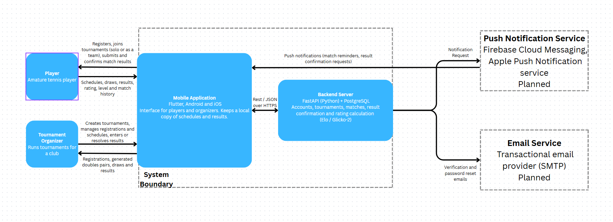

# System Context Diagram

The diagram shows the Amateur Tennis Community Platform as a single system, the people who use it, and the external services it depends on. The dashed frame marks the system boundary. Everything inside it is built by our team, and everything outside it is a person or a third-party service.

Inside the boundary we show only the two main parts, so it's clear where the mobile app sits:

- **Mobile Application.** The Flutter app for Android and iOS that players and organizers use. It can keep a local copy of schedules and results (an optional offline cache, planned).
- **Backend Server.** The FastAPI application with its PostgreSQL database. It handles accounts, tournaments, matches, result confirmation and rating calculation (Glicko-2).

The two parts talk to each other through a REST/JSON API over HTTPS.

## Actors

- **Player.** An amateur tennis player who registers, joins tournaments (alone or as a premade team), submits match results, confirms or disputes the results their opponents submit, and follows their schedule, rating, level and match history.
- **Tournament Organizer.** A person who runs tournaments for a club or community: creates tournaments, manages registrations and schedules, and resolves disputed results. Organizers do not enter or confirm results on behalf of players. The organizer sees registration lists, automatically generated doubles pairs, draws and results.

## External services

Both external services are shown with dashed borders because they are planned: push notifications are a "could have" feature, and the email service is needed for password reset and email verification, which are "should have" features (see `docs/requirements/requirement-priorities-and-acceptance-criteria.md`). They are not required for the first version.

- **Push Notification Service.** Firebase Cloud Messaging for Android and Apple Push Notification service for iOS. The backend sends notification requests, and the service delivers match reminders and result confirmation requests to the app.
- **Email Service.** A transactional email provider used for account verification and password reset.

## Main information flows

| From | To | Information |
|---|---|---|
| Player | Mobile app | Registration, tournament sign-ups (solo or team), submitted results, confirmations and disputes |
| Mobile app | Player | Schedules, draws, results, rating, level and match history |
| Organizer | Mobile app | New tournaments, registration and schedule management, resolutions of disputed results |
| Mobile app | Organizer | Registration lists, generated doubles pairs, draws and results |
| Mobile app | Backend | REST/JSON requests and responses over HTTPS |
| Backend | Push service | Notification requests |
| Push service | Mobile app | Push notifications |
| Backend | Email service | Verification and password-reset emails |

## Files

- `image.png`: exported image of the diagram. The editable source is not yet in the repository; when it is added, export the image again after each edit so the two stay in sync.
