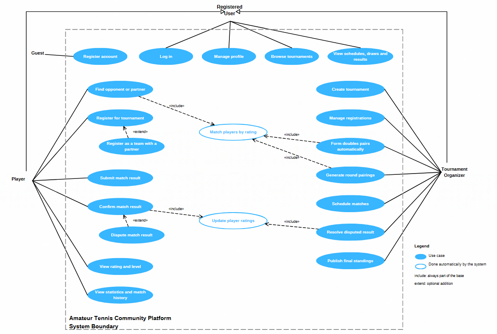

# Use Case Diagram

The diagram shows what people can do with the Amateur Tennis Community Platform. The rectangle is the system, the ovals inside it are use cases, and the stick figures outside are the actors.

## Actors

- **Guest.** Someone without an account. The only thing they can do is register.
- **Registered User.** Any logged-in user. Player and Tournament Organizer both inherit from it (the hollow-arrow lines), so everything a Registered User can do is also available to both of them. One person can be a player and an organizer at the same time.
- **Player.** An amateur player who looks for opponents and partners, registers for tournaments, reports results and follows their rating.
- **Tournament Organizer.** Someone who creates and runs tournaments for a club or community.

Notifications and admin functions are not shown. Notifications are still subject to scope prioritization, and there is no admin role in the current scope.

## Use cases

The two shaded use cases (UC-14 and UC-15) are done automatically by the system. They have no actor of their own and are reached only through include from other use cases.

| ID | Use case | Actor | Relationship | What it means |
|---|---|---|---|---|
| UC-01 | Register account | Guest | | Create an account with email and password |
| UC-02 | Log in | Registered User | | Sign in to the app |
| UC-03 | Manage profile | Registered User | | Edit name, contact details and self-assessed starting level |
| UC-04 | Browse tournaments | Registered User | | See upcoming and running tournaments |
| UC-05 | View schedules, draws and results | Registered User | | See match times, draws and results of a tournament |
| UC-06 | Find opponent or partner | Player | includes UC-14 | Get suggestions for players at a similar level |
| UC-07 | Register for tournament | Player | | Sign up for a singles or doubles tournament as an individual |
| UC-08 | Register as a team with a partner | Player | extends UC-07 | Sign up together with a chosen partner instead of individually |
| UC-09 | Submit match result | Player | | Enter the score of a played match |
| UC-10 | Confirm match result | Player | includes UC-15 | The opponent confirms the submitted score, which triggers the rating update |
| UC-11 | Dispute match result | Player | extends UC-10 | The opponent rejects the score instead of confirming it |
| UC-12 | View rating and level | Player | | See the internal rating and the NTRP-style level shown to players |
| UC-13 | View statistics and match history | Player | | See past matches, wins and losses, and rating history |
| UC-14 | Match players by rating | System | | Find players or teams with a similar rating. Used for suggestions, doubles pairs and round pairings. |
| UC-15 | Update player ratings | System | | Recalculate the ratings (Elo or Glicko-2) of everyone in a confirmed match |
| UC-16 | Create tournament | Organizer | | Set name, dates, format (singles or doubles) and rules |
| UC-17 | Manage registrations | Organizer | | Accept or remove registrations and close sign-up |
| UC-18 | Form doubles pairs automatically | Organizer | includes UC-14 | Pair players who registered individually into balanced doubles teams |
| UC-19 | Generate round pairings | Organizer | includes UC-14 | Pair players or teams for the next round based on standings and rating (Swiss-style rounds) |
| UC-20 | Schedule matches | Organizer | | Assign times and courts to matches |
| UC-21 | Resolve disputed result | Organizer | includes UC-15 | Decide the correct score when players disagree |
| UC-22 | Publish final standings | Organizer | | Finish the tournament and publish the final table |

## Relationships

- **include**: the included use case always runs as part of the base one. For example, confirming a result always updates ratings.
- **extend**: the extending use case is an optional variation. For example, a player may register with a partner instead of alone, or dispute a result instead of confirming it.
- **Generalization**: Player and Tournament Organizer are both Registered Users.

## Mapping to the project scope

Every item in the project scope is covered by at least one use case.

| Scope item | Use cases |
|---|---|
| User registration, authentication and player profiles | UC-01, UC-02, UC-03 |
| Tournament creation and management | UC-04, UC-16, UC-17, UC-22 |
| Singles and doubles tournament formats | UC-16, UC-07 |
| Individual and premade-team registration | UC-07, UC-08, UC-17 |
| Automatic doubles partner formation | UC-18, UC-14 |
| Tournament scheduling and match management | UC-05, UC-19, UC-20 |
| Match result submission and confirmation | UC-09, UC-10, UC-11, UC-21 |
| Internal player rating (Elo or Glicko-2) | UC-15 |
| NTRP-inspired displayed player levels | UC-12 |
| Player statistics and match history | UC-13 |
| Rating-based matchmaking (project goal) | UC-06, UC-14 |

## Files

- `image-1.png`: Usecase diagram image.
